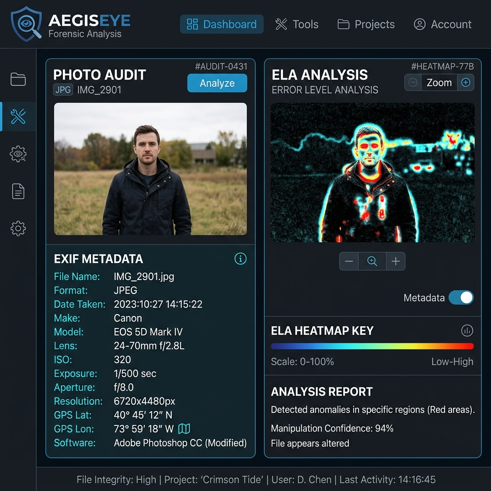

# AegisEye: Premium OSINT & Digital Forensics Toolkit 🛡️🔎

[](https://www.python.org/)
[](https://opensource.org/licenses/MIT)
[]()
[]()

**AegisEye** is a comprehensive, multi-functional tool designed for digital forensics, open-source intelligence (OSINT), and file analysis. It offers 5 specialized command-line modules that perform advanced static file forensics, visual image tamper checks (Error Level Analysis), network reconnaissance, cryptographic strength auditing, and secure military-grade file shredding.

---

## 📸 Forensic Audit Dashboard Preview


---

## 🚀 Toolkit Modules & Features
- **🔍 Image Analysis (`image` command):** Audits EXIF data, extracts GPS coordinates, performs Error Level Analysis (ELA) to locate pixel manipulations, and checks for spoofed formats or hidden malware payloads.
- **📞 Phone & Email OSINT (`osint` command):** Checks phone number carriers and email MX records.
- **🗑️ Forensic File Shredder (`shred` command):** Overwrites targets using DoD 5220.22-M military standards to prevent any forensic lab recovery.
- **🌐 Network Recon (`domain` command):** WHOIS socket queries, active DNS record audits, and SSL certificate health checks.
- **🔑 Cryptography (`crypto` command):** Classifies hash formats and audits password strength entropy.

---

## 🚀 Step-by-Step Installation & Setup

### Step 1: Clone the Repository (Download karein)
Open your terminal and clone the repository:
```bash
git clone https://github.com/Neeshant01/aegiseye-forensics.git
cd aegiseye-forensics
```

### Step 2: Setup Virtual Environment (Venv configure karein)
Setting up a python virtual environment prevents the `externally-managed-environment` error:
```bash
python3 -m venv venv
source venv/bin/activate
```

### Step 3: Install Dependencies (Packages install karein)
Install all required python packages:
```bash
pip install -r requirements.txt
```

### Step 4: Run Audits (Run karein)

#### 🎮 Interactive TUI Menu Mode (Recommended)
Run the script without any options to launch the interactive TUI menu. You can perform all operations (forensics, OSINT, secure shredding, crypto audits) by entering options `1-9`:
```bash
python aegiseye.py
```

#### 💻 Direct Command-Line CLI Mode
You can also run specific modules directly using subcommand arguments:
```bash
# General Help menu
python aegiseye.py --help

# Scan local image ELA/EXIF
python aegiseye.py image photo.jpg

# Securely wipe a file (5 passes)
python aegiseye.py shred secret.txt --passes 5
```

---

## 🔌 Model Context Protocol (MCP) Server Integration
AegisEye is fully integrated as a Custom MCP Server, satisfying the **Find Evil! Hackathon** Approach 2 architecture. This allows autonomous incident response agents (like Claude Code, OpenClaw, or Cursor) to call AegisEye tools natively over stdio.

### Exposed MCP Tools
1. `analyze_image(image_path)`: Scans an image for EXIF/GPS, runs ELA pixel-tamper checks, splits RGB channels, and returns a compiled HTML report path.
2. `check_email_osint(email)`: OSINT validator checking domain syntax and active mail server MX records.
3. `check_phone_osint(phone)`: OSINT auditor for carrier information, timezone, and geolocation country mapping.
4. `audit_domain_network(domain, check_whois)`: Network audit engine checking active DNS, WHOIS registration, and SSL/TLS certificate health status.
5. `crypto_hash_analysis(hash_string, password)`: Identifies cryptographic hash algorithm types or evaluates password strength entropy.

### Running AegisEye as an MCP Server
To configure and run the MCP server with an agentic client (e.g. `claude.json` or Cline configuration):
```json
{
  "mcpServers": {
    "aegiseye-forensics": {
      "command": "python3",
      "args": ["/absolute/path/to/aegiseye-forensics/aegiseye_mcp.py"]
    }
  }
}
```

### Verification Against Evidence
We have pre-packaged a forensic test dataset in the `evidence/` directory:
- `evidence/clean_evidence.jpg`: Clean system configuration screenshot.
- `evidence/tampered_evidence.jpg`: Manipulated system configuration screenshot.

You can verify the agent's behavior by instructing the agent:
> *"Analyze /absolute/path/to/aegiseye-forensics/evidence/tampered_evidence.jpg for visual modifications and report the findings."*
The agent will call `analyze_image` through the MCP protocol, read the ELA heatmap results, detect the pixel manipulation anomalies, and report them autonomously.

---

## 📖 Complete Setup & Troubleshooting Guide
For advanced debugging (e.g. fixing PIL/Pillow compiler issues or setting up coordinates maps), read the [SETUP_GUIDE.md](./SETUP_GUIDE.md).

---

## 📄 License
Distributed under the MIT License.

