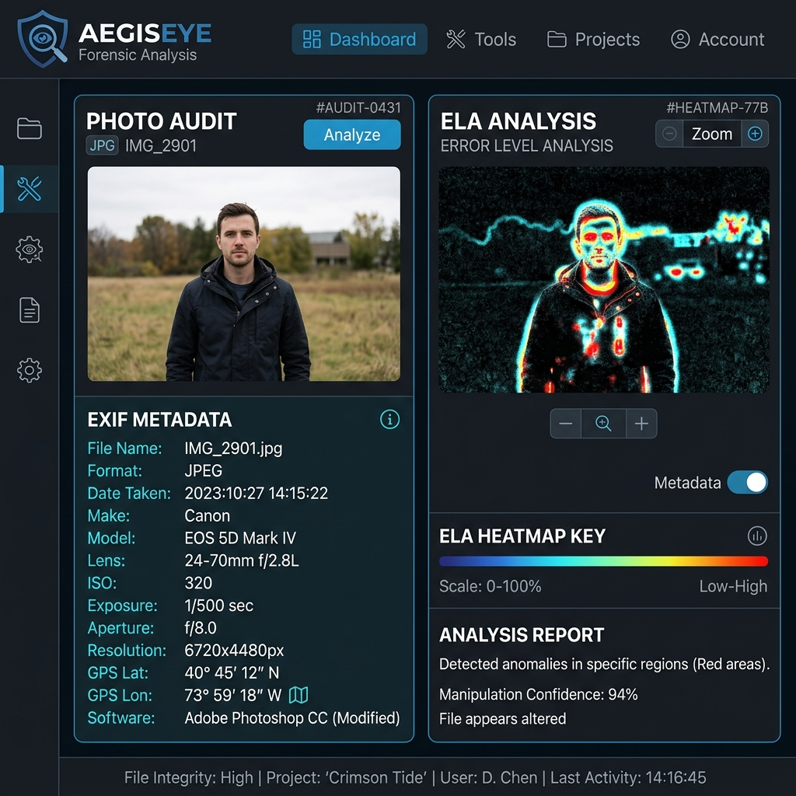
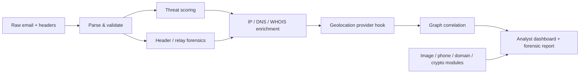

# AegisEye Forensics: Setup & Troubleshooting Guide

This guide details setup instructions and module diagnostics for the **AegisEye digital forensics toolkit**, including the SIH 2026 email-threat triage workflow.

---

## 1. Visual Overview & Architecture

### AegisEye Image Audit Dashboard


### Forensic Pipelines Flowchart


The email analyzer is a local, read-only triage layer. It produces an evidence SHA-256 hash, parses authentication and relay signals, and reports origin IP candidates. It does not infer a sender’s location or identity from a single IP address.

---

## 2. Setup & Execution

### Step 1: Clone the Repository
```bash
git clone https://github.com/sudonishant/aegiseye-forensics.git
cd aegiseye-forensics
```

### Step 2: Install Packages
```bash
python3 -m venv venv
source venv/bin/activate
pip install -r requirements.txt
```

### Step 3: Run Forensics
```bash
python3 aegiseye.py --help
```

To run an ELA and metadata scan on an image:
```bash
python3 aegiseye.py image photo.jpg
```

To triage a raw RFC 5322 email and generate an HTML report:
```bash
python3 aegiseye.py email evidence/suspicious_email.eml
```

To export the complete structured result as JSON:
```bash
python3 aegiseye.py email evidence/suspicious_email.eml --json
```

The synthetic fixture `evidence/suspicious_email.eml` is safe for testing and includes failed SPF/DKIM/DMARC results, a mismatched Reply-To domain, a shortened URL, a Punycode lookalike, urgency language, two relay IPs, and a macro-enabled attachment name.

---

## 3. Email-Threat Analysis Output

The `email` command returns or reports the following evidence groups:

| Group | Contents |
|---|---|
| Message identity | From, display name, Reply-To, Return-Path, Date, Message-ID, sender domains |
| Authentication | SPF, DKIM, DMARC, DKIM-signature presence |
| Relay forensics | Received headers, parsed relay IPs, earliest origin candidate |
| Indicators | URLs, link hosts, Punycode, shorteners, attachments, urgency terms |
| Risk | Explainable finding codes, severity, recommendation, score from 0–100 |
| Evidence | Raw-email SHA-256, read-only mode, chain-of-custody note |

The HTML report is written beside the input file by default using the suffix `_aegiseye_email_report.html`. Use `--report /path/to/report.html` to override the output path.

---

## 4. Troubleshooting Guide

### Error 1: PIL/Pillow Import Errors
- **Cause:** Pillow was not installed correctly in the active Python environment.
- **Fix:** Reinstall Pillow within the active virtual environment:
  ```bash
  pip install --force-reinstall Pillow
  ```

### Error 2: ELA generation fails with “Permission Denied”
- **Cause:** The target image is in a system directory where write permissions are restricted.
- **Fix:** Copy the target image into a user-writable directory or pass an accessible output location.

### Error 3: OSINT carrier checks return empty carriers
- **Cause:** Phone-number metadata can be unavailable for some number ranges or input formats.
- **Fix:** Use standard international E.164 format including the country code, for example `+919876543210`.

### Error 4: Email report shows no origin IP
- **Cause:** The raw message may omit `Received` headers, include only IPv6/provider-specific formats, or be copied without the original source.
- **Fix:** Preserve and export the original `.eml` from the mail client or gateway. Use upstream gateway logs for additional relay evidence.

### Error 5: Geolocation or attribution is unavailable
- **Cause:** The local analyzer intentionally does not call an external IP-intelligence provider by default.
- **Fix:** Add an approved provider through a controlled integration, preserve the provider response as evidence, and treat geolocation as a confidence-scored clue rather than proof of sender identity.

---

## 5. Evidence-Safety Notes

The email analyzer is read-only and never modifies the input message. Keep the original `.eml` and the generated SHA-256 hash together. The secure-shredder command is irreversible; do not run it on original evidence unless permanent disposal is explicitly authorized.
