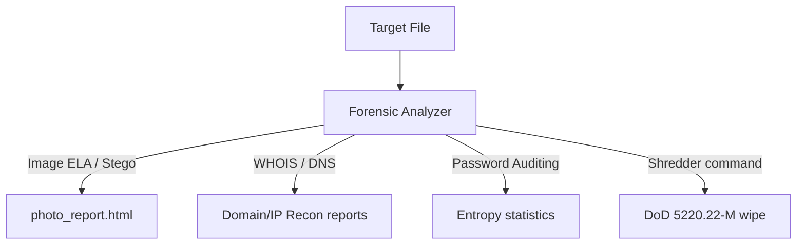

# AegisEye Forensics: Setup & Troubleshooting Guide

This guide details setup instructions and module diagnostics for the **AegisEye digital forensics toolkit**.

---

## 1. Visual Overview & Architecture

### AegisEye Image Audit Dashboard


### Forensic Pipelines Flowchart


---

## 2. Setup & Execution (Hindi + English)

### Step 1: Clone the Repository (Download karein)
```bash
git clone https://github.com/Neeshant01/aegiseye-forensics.git
cd aegiseye-forensics
```

### Step 2: Install Packages (Dependencies setup karein)
```bash
python3 -m venv venv
source venv/bin/activate
pip install -r requirements.txt
```

### Step 3: Run Forensics (Verify karein)
```bash
python3 aegiseye.py --help
```
For example, to run an ELA and Metadata scan on an image:
```bash
python3 aegiseye.py image photo.jpg
```

---

## 3. Troubleshooting Guide (Common issues)

### Error 1: PIL/Pillow Import Errors
- **Cause:** PIL library was not compiled correctly on your Python environment.
- **Fix:** Reinstall Pillow within active venv:
  ```bash
  pip install --force-reinstall Pillow
  ```

### Error 2: ELA generation fails with "Permission Denied"
- **Cause:** You are trying to scan an image located in a system directory where write permissions are restricted.
- **Fix:** Copy the target image inside the `aegiseye-forensics` folder or run it with user write-access directories.

### Error 3: OSINT carrier checks return empty carriers
- **Cause:** Phone number OSINT carriers require active lookup libraries.
- **Fix:** Ensure you have input the phone number in standard international E.164 format including country code:
  - Example: `+919876543210`
